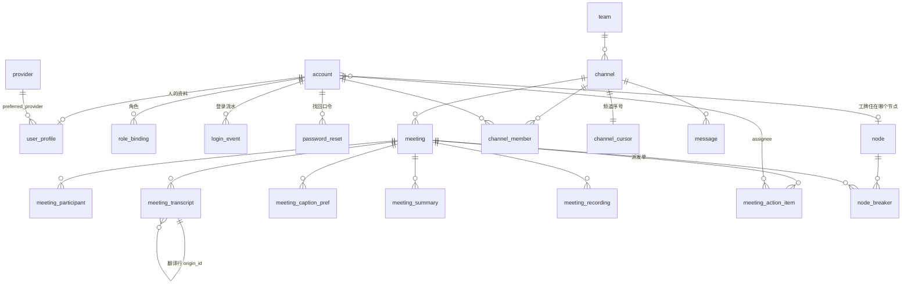

# Muster 数据库设计(2026-11-03)

> 服务端(muster-server)的 PostgreSQL 库 `muster`。本文是**现状的正式说明**,与 `muster-server/migrations/0001–0006` 一一对应;
> 改表先改迁移,再回来改这里。桌面壳本机的 state.db(SQLite)与各节点的审计链(muster-audit,SQLite)不在本文范围。

## 0. 先说清几条贯穿全库的约定

| 约定 | 为什么 |
|---|---|
| **时间一律 `BIGINT` 毫秒(epoch ms),列名以 `_ms` 结尾** | 与审计链、JWT、前端用同一种时间,不在时区上翻车;比较和排序是整数 |
| **主键用 `TEXT` 的可读 id(账号、团队、频道、provider)或 `UUID`(会议、消息、录制、节点)** | 可读 id 进 URL、进审计 actor、进 LiveKit identity,人看得懂;事件型实体用 UUID 避免猜测与撞号 |
| **停用而不删除**(account.disabled、provider.enabled) | 删了,历史里的作者、"上周那次任务走的哪条通道"就成了孤儿 |
| **库里是元数据 + 正文的存储侧,审计链里只有哈希**(铁律三) | 转写、总结、录像都可导出、可按保留期清;链上只有它们的哈希 |
| **密钥永不进库**(provider.api_key_env 是环境变量的**名字**;password_hash 是 Argon2;password_reset.token_hash、node.poll_token_hash 是 SHA-256) | 库被拖走也拿不到任何凭据 |
| **迁移只加表、加列、加索引,全部 `IF NOT EXISTS`,服务端启动时按顺序执行**(`db.rs`) | 幂等,重部署不用手动跑脚本;回滚预案是部署前自动的 pg_dump |
| **外键一律带 `ON DELETE`**:从属数据 `CASCADE`,引用关系 `SET NULL` | 删一个团队连带它的频道、消息;删一个节点只把工牌上的 node_id 清空 |

## 1. 总览(ER 图)

五个簇:**身份**(account / user_profile / role_binding / login_event / password_reset)、**组织**(team / channel / channel_member / channel_cursor / stream_cursor / org_setting)、
**消息**(message)、**会议**(meeting 及其 7 张从表)、**节点与模型**(node / node_breaker / provider)。

## 2. 身份

### account —— 能登录的主体(0001;0003 加 node_id;0005 加 pending;0006 加登录快照)

| 列 | 类型 | 说明 |
|---|---|---|
| id | TEXT PK | 账号 id。自助注册的只许小写字母、数字、`. _ -`,3–32 位(signup.rs);它同时是审计 actor、LiveKit identity、头像文件名 |
| display_name | TEXT NN | 显示名 |
| password_hash | TEXT | Argon2 PHC 串;接 OIDC 后可空 |
| kind | TEXT NN = 'human' | `human` / `agent`(工牌)/ `service`,与 muster_identity::PrincipalKind 同源 |
| ext_iss, ext_sub | TEXT | 外部身份(OIDC),当前为空;`UNIQUE(ext_iss, ext_sub)` |
| created_ms | BIGINT NN | |
| disabled | BOOL NN = false | 停用。登录与枚举防护:停用、不存在、口令错三者回同一句话 |
| node_id | UUID → node.id SET NULL | 工牌住在哪个节点(只有 kind=agent 用) |
| pending | BOOL NN = false | 自助注册待批准。口令对了才告诉登录者这个状态 |
| last_login_ms, last_login_ip | BIGINT, TEXT | 最近一次成功登录的快照(流水在 login_event) |
| failed_logins | INT NN = 0 | 自上次成功以来连续失败次数;成功即清零 |

### user_profile —— 关于这个人的信息(0006)

只有 `kind = human` 的账号有一行;与 account 分表是因为工牌、服务账号没有邮箱和头像。

| 列 | 类型 | 说明 |
|---|---|---|
| account_id | TEXT PK → account.id CASCADE | |
| email | TEXT | 小写规范化后存;**部分唯一索引 `uq_user_profile_email` on `lower(email)` where not null**:唯一且不分大小写,没填的不占位 |
| email_verified | BOOL NN = false | 邮件通道接上之前恒为 false;邮箱一改就回到 false |
| avatar_path | TEXT | 头像**文件名**;文件在 `MUSTER_AVATARS_DIR`(容器 `/data/avatars`),最大 512 KiB,按魔数只认 PNG / JPEG / WebP |
| department, title | TEXT | 各 ≤ 60 字符 |
| bio | TEXT | ≤ 500 字符,允许换行 |
| preferred_provider | TEXT → provider.id SET NULL | 偏好的模型通道;空 = 跟组织默认。只能指向目录里**启用**的通道 |
| created_ms, updated_ms | BIGINT NN | |

### role_binding —— 谁在哪个范围是什么角色(0001)

| 列 | 类型 | 说明 |
|---|---|---|
| id | BIGSERIAL PK | |
| account_id | TEXT NN → account.id CASCADE | |
| role | TEXT NN | owner / admin / group_admin / publisher / approver / member / guest(auth.rs parse_role;认不出的角色**丢弃并暴露**,不降级) |
| scope_kind | TEXT NN | `org` / `group` / `channel` |
| scope_id | TEXT | group 时是 team.id,channel 时是 channel.id,org 为空 |
| created_ms | BIGINT NN | |
| | `UNIQUE(account_id, role, scope_kind, scope_id)` | |

判定在 muster-identity 的 `can()`,每次请求现查绑定、**不进 JWT**:令牌 12 小时有效,角色烤进去等于降权要等 12 小时。
自助注册批准即插入 `(member, org)`;最后一个 owner 撤不掉。

### login_event —— 登录流水(0006)

| 列 | 类型 | 说明 |
|---|---|---|
| id | BIGSERIAL PK | |
| account_id | TEXT NN → account.id CASCADE | **只记存在的账号**;不存在的不记,否则这张表就成了枚举器的日志 |
| ok | BOOL NN | |
| reason | TEXT | 失败原因 `bad_password` / `disabled` / `pending`;成功为空 |
| ip, user_agent | TEXT | ip 经 `MUSTER_TRUST_PROXY` 决定信不信 X-Forwarded-For;UA 截 200 字符 |
| ts_ms | BIGINT NN | 索引 `(account_id, ts_ms DESC)` |

### password_reset —— 找回口令的一次性令牌(0006)

| 列 | 类型 | 说明 |
|---|---|---|
| id | UUID PK | |
| account_id | TEXT NN → account.id CASCADE | |
| token_hash | TEXT NN UNIQUE | 64 位随机令牌的 SHA-256;明文只在签发那一次响应里出现 |
| issued_by | TEXT | 管理员签发时记谁;本人凭邮箱申请为空 |
| expires_ms | BIGINT NN | 签发 + 30 分钟 |
| used_ms | BIGINT | 用过即填,不再可用 |
| created_ms | BIGINT NN | |

邮件通道未接:凭邮箱申请只签发不投递,接口如实回 `delivery: "none"`;正路是管理员签发链接转交本人。

## 3. 组织

### team(0001)

`id TEXT PK, name TEXT NN, created_ms`。角色作用域里的 `group` 指它。

### channel(0001)

| 列 | 说明 |
|---|---|
| id TEXT PK, team_id → team CASCADE, name | |
| level TEXT NN = 'open' | `open` / `internal` / `restricted`,与 muster_route::Sensitivity 同源;会议继承它 |
| private BOOL | |
| created_ms | 索引 `(team_id)` |

### channel_member(0001)

`PK(channel_id, account_id)`,双向 CASCADE,`joined_ms`。派发单的候选负责人、"能在这个频道里行动的人"都从这里出。

### channel_cursor(0001)

每频道一行 `next_seq`,`UPDATE … RETURNING` 发号。单独一行做行锁,避免 `MAX(seq)+1` 的并发空洞。

### stream_cursor(0001)

全库**单行**(`CHECK (id = 1)`)的全局投递序号,给 SSE 断线补拉。不用 BIGSERIAL:序列号在事务外分配,
拿到 5 的事务可能比拿到 6 的晚提交,消费者按 `id > last` 拉就永久漏掉 5;单行游标锁持有到提交,**加锁顺序即提交顺序**。

### org_setting(0003)

键值表 `key PK, value, updated_by, updated_ms`。现有键:`duty_badge`(值班工牌)、`registration`(自助注册模式 closed / approval / open,缺省 approval;读不懂的值按 closed 处理)。

## 4. 消息

### message(0001;0002 加幂等键)

| 列 | 说明 |
|---|---|
| id UUID PK, channel_id → channel CASCADE | |
| channel_seq BIGINT NN | **投递序**,每频道无空洞;`UNIQUE(channel_id, channel_seq)` |
| stream_seq BIGINT | 全局投递序(stream_cursor 发),索引 |
| author_id, role, body, run_id, ts_ms | role:human / agent / system;run_id 关联任务 |
| idempotency_key TEXT | 部分唯一索引 `(author_id, idempotency_key) where not null`:同作者同键只落一条 |

**channel_seq 是投递序,不是证据序**——证据序是各节点自己的哈希链。两者要求不同,别拿一个实现另一个。

## 5. 会议

### meeting(0001;0003 加 agent_requested_ms;0004 加 host)

| 列 | 说明 |
|---|---|
| id UUID PK, channel_id → channel CASCADE, title, room(LiveKit 房间名) | |
| level | 会议密级,继承频道,E3 棘轮只升不降 |
| started_ms, ended_ms | ended 为空 = 进行中(部署脚本只把最近 12 小时开的算"进行中") |
| wants_agent BOOL | 「请 Agent」只是**意愿**,由组织节点认领;部分索引 where wants_agent |
| agent_requested_ms | 最近一次「请 Agent」的时刻,节点据此判断熔断该不该解除 |
| host TEXT | 主持人(建会的人),派发单没解析出负责人时由他指派 |

媒体面在 LiveKit,这里只存 Muster 关心的那一半:谁在场、密级、转写、产出了哪些任务。

### 从表

| 表 | 主键 / 索引 | 说明 |
|---|---|---|
| meeting_participant | PK(meeting_id, account_id, joined_ms) | 进出记录;`left_ms` 空 = 还在;Agent 退出也记一笔 |
| meeting_transcript | BIGSERIAL;`(meeting_id, ts_ms)` | **正文存储侧**:speaker_id、text、lang(0001 后加,默认 zh)、`origin_id → 自身`(翻译行指回原文行,CASCADE)。审计链里只有每行的哈希 |
| meeting_caption_pref | PK(meeting_id, account_id) | 每个参会者选的字幕语言;Agent 据此决定翻哪些语言,没人要的不翻 |
| meeting_summary | BIGSERIAL;`(meeting_id, created_ms)` | 散会回顾 / 会中小结:kind、text、author_id、model |
| meeting_recording | UUID;`(meeting_id, started_ms)` | 自托管 Egress 的元数据:egress_id、status(starting / active / stopping / ready / failed)、filepath、size、duration、**content_hash**(文件哈希入链)、error;restricted 禁录在入会票与服务端两处拦 |
| meeting_action_item | UUID;`(meeting_id, created_ms)`、`(status)`、`(assignee, status)` | 见下 |

### meeting_action_item —— 派发单(0001;0004 收窄确认权)

**这是提案,不是任务**:会上一句话不能直接变成在别人机器上跑的代码改动,人确认那一步是授权边界。

| 列 | 说明 |
|---|---|
| text | 模型提炼的行动项 |
| owner_hint | 会上提到的负责人,**可能是转错的名字**,只作提示 |
| source_quote | 出处原话,让人核对"它是不是听岔了" |
| status | proposed / confirmed(老行)/ accepted / rejected / expired / done |
| assignee → account SET NULL | 被派到的本人;**只有本人能接受 / 驳回**,Agent、主持人、管理员都不能替他点;必须是频道里的人员账号(Agent 工牌不行) |
| accepted_mode | self(本人做)/ private(交给私有 Agent,明确不做,留空) |
| sensitivity | 来源密级(会议密级),将来任务从这个密级起步 |
| source_kind | 默认 meeting |
| decided_by, decided_ms, reject_reason | 驳回必须带理由(审计里只留哈希) |
| assigned_by, assigned_ms | 指派 / 改派留痕 |
| expires_ms | 提出 + 72 小时没人处理 ⇒ expired,提醒主持人,**不自动转派** |
| run_id | 接受后由节点跑起来的 run;服务端只记号不执行 |

## 6. 节点与模型

### node(0003)

| 列 | 说明 |
|---|---|
| id UUID PK, name | |
| owner_account → account SET NULL | 空 = 组织节点;非空 = 某人的私有节点 |
| pubkey BYTEA NN UNIQUE | ed25519 公钥;节点只交公钥,会话靠签 challenge 换 |
| capabilities JSONB | 如 `{"stt_local": true}`;值班工牌所在节点必须有本地转写能力(边界五) |
| status | pending(等批准)/ approved / revoked |
| user_code TEXT UNIQUE | 设备码,批准前有效 |
| poll_token_hash | 轮询批准状态用的令牌,只存哈希 |
| approved_by, approved_ms, last_seen_ms(90 秒没心跳 = 工牌不可用), last_progress_ms / kind, version, created_ms | |

### node_breaker(0003)

`PK(node_id, meeting_id)`:节点上报的熔断——对哪场会、什么错类、连续几次。人再点「请 Agent」即清掉。

### provider —— 模型通道目录(0001)

| 列 | 说明 |
|---|---|
| id TEXT PK, kind(openai_compat), base_url, model, display_name | |
| locality | `local` / `cloud`(CHECK)。**决定 restricted 内容能不能出门**,所以必须集中在服务端下发,不能由各节点自己声明(边界六) |
| api_key_env | 环境变量**名**,值只在各节点自己的环境里 |
| timeout_secs, enabled(停用不删), is_default | 默认通道只能有一个:部分唯一索引 `(is_default) where is_default`,并发的"设为默认"应用层挡不住 |
| created_ms, updated_ms | 写这张表要 ChangePolicy |

## 7. 接口 ↔ 表 对照(身份相关)

| 接口 | 读 / 写 |
|---|---|
| `POST /auth/login` | 读 account;写 login_event + account 快照 |
| `POST /auth/register` | 写 account(pending 按 org_setting.registration)、user_profile;open 模式再写 role_binding(member@org) |
| `POST /accounts/:aid/approve` | account.pending=false;写 role_binding |
| `GET/PUT /me/profile` · `POST /me/avatar` · `GET /avatars/:aid` | user_profile(+ account.display_name);头像文件在文件系统 |
| `GET /me/logins` · `GET /accounts/:aid/logins` · `GET /accounts/:aid/profile` | login_event |
| `POST /accounts/:aid/reset-link` · `POST /auth/recover` · `POST /auth/reset` | password_reset;reset 成功写 account.password_hash |
| `GET/POST /org/registration` | org_setting |

所有改权限、改凭据的动作(建号、授权、批准、改模式、改口令、签发重置)都落审计链 `badge.update`,正文只留哈希。

## 8. 运维

- **备份**:`deploy/to-server.sh` 每次重部署前 `pg_dump` 到 `/opt/muster-backups/`;尚无定时备份(建议 cron 每日一份、保留 30 天)。
- **暴露面**:生产 compose 不映射 PostgreSQL 端口,只有 compose 内网能连;头像与审计库在 `/data` 卷,录像在 `/out` 卷。
- **直接改库**:可以 `docker compose exec postgres psql`,但绕过审计,只用于排障;日常管理走桌面壳「编制」页或 `muster-admin`。
- **保留期**:转写、总结、录像是正文侧,可按组织策略清理;审计链不动。登录流水暂无自动清理(按账号索引,量不大)。
